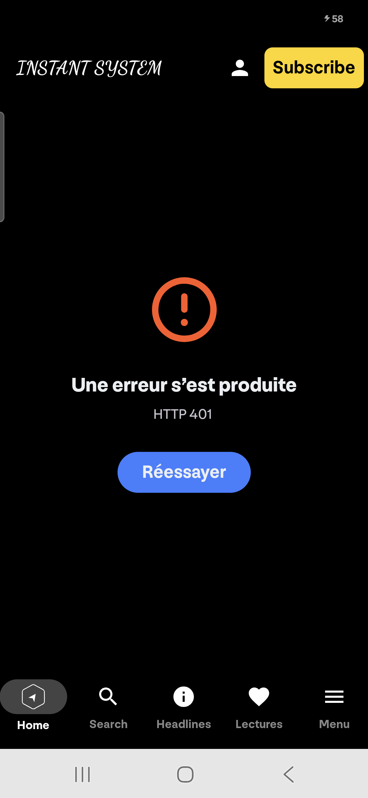

# 📰 News App

A modern Android application that displays the latest top headlines using the [NewsAPI.org](https://newsapi.org/docs).  
Developed with Jetpack Compose and Kotlin using a Clean Architecture approach.

## ✨ Features

- 🔍 Search news articles dynamically
- 🧭 Browse top headlines by categories
- 🔖 Bookmark articles and read them later in the "Lectures" tab
- 📱 Adaptive layout with master-detail (tablet-friendly)
- 🌙 Modern UI with Material 3
- ✅ Unit and UI tests (ViewModel, UseCases, Composables)

---

## 🔑 Setup: NewsAPI key

The app needs a free [NewsAPI.org](https://newsapi.org/register) API key. It is read at build time from
`local.properties` (at the root of the project, never committed):

```properties
NEWS_API_KEY=your_api_key_here
```

Then rebuild the app. Without this key the app still compiles, but every screen shows
"Clé API NewsAPI manquante…" ("NewsAPI key missing…" in English) instead of articles.

---

## 🧠 Architecture

The app uses **Clean MVVM Architecture** with the following layers:

- **UI Layer**: Jetpack Compose + Hilt-powered ViewModels  
- **Domain Layer**: Use cases + repository interfaces (business rules)  
- **Data Layer**: Retrofit API, Paging3 integration

This ensures:
- Separation of concerns
- Easy testability
- Scalability
- Maintainability

> All business logic is handled by UseCases, and UI does not depend on data sources.

---

## 🛠️ Tech Stack

| Layer        | Tools / Libraries                             | Why |
|--------------|-----------------------------------------------|-----|
| UI           | Jetpack Compose, Material 3                   | Modern, declarative UI |
| Navigation   | `NavigableListDetailPaneScaffold` (Material 3 adaptive) | Adaptive layouts |
| DI           | Hilt                                          | Clean dependency management |
| Networking   | Retrofit + OkHttp                             | Standard, robust API handling |
| Paging       | Paging 3                                      | Efficient pagination |
| Image Loading| Coil                                          | Fast and lightweight |
| Testing      | JUnit, Turbine, Mockk, Compose UI testing     | Full test coverage support |

---

## 🧪 Tests

| Layer     | Covered | Details |
|-----------|---------|---------|
| `data`    | ✅      | Retrofit, data source, error mapping |
| `domain`  | ✅      | UseCase logic |
| `ui`      | ✅      | ViewModels, key Composables (LoaderScreen, ErrorStateScreen, SearchScreen, etc.) |

---

## 🧩 Choices & Tradeoffs

- **Jetpack Compose**: To build modern UIs with less boilerplate.
- **Material 3 Adaptive Navigation**: To demonstrate ability to build tablet-friendly master-detail views.
- **No Room/Offline Support**: Given the scope, I prioritized API interaction and UI instead of offline storage.
- **Bookmarks without Room**: Bookmarked articles are stored on the device in SharedPreferences (JSON via Gson, already
  used by Retrofit), to avoid a database for a short list.
- **Single Activity architecture**: Recommended pattern with Compose Navigation.

---

## 🚧 Known limitations / improvements

- 🌐 No offline caching (Room + RemoteMediator could be added)
- 🌍 The home feed follows the device language (English when NewsAPI does not support it), but top headlines are
  still hardcoded to the "us" country
- 🕘 Recent searches are kept for the session only
- 🧪 No end-to-end (instrumented) tests, only UI + unit tests

---

## Screenshots

<p align="center">
  
</p>


## 💬 Final thoughts

This project is a concise but solid example of a real-world news application. I prioritized maintainable structure, modern Android practices, and UI responsiveness.

⏱️ **Time spent: ~20h**

Please feel free to reach out if you want me to walk through any section of the code!

Thanks for the opportunity 🙌  
— Kevin Hermann
